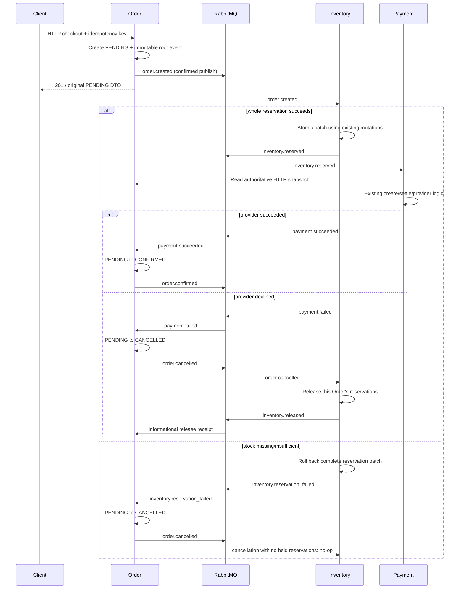

# Phase 7: Feature-gated event-driven checkout

## Existing synchronous flow and migration

`POST /orders` calls `createOrderService`; cart checkout at `POST /orders/checkout`
claims `(userId, idempotencyKey)` in CheckoutIdempotency first. Order aggregates
items, reads Catalog snapshots, calculates Decimal totals, checks Inventory over
HTTP, and reserves each product using `attemptId:reserve:productId`. A local Order
transaction writes Order/items/delivery. Failed creation releases prior reservations
using `attemptId:release:productId`; ambiguous compensation is recorded durably.
Cart deletion uses existing durable checkout finalization/replay behavior.

Payment is a separate client/admin-driven HTTP workflow in the existing backend;
Order creation does **not** itself call Payment. Payment reads the internal Order
snapshot, persists attempts, settles through its provider, and confirms Order over
HTTP. Payment creation uses user/action/key constraints and an Order advisory lock;
settlement uses Payment row locks, committed intent and independent provider receipts.
Order cancellation records durable pending intent, releases Inventory over HTTP,
then commits CANCELLED. Processing consumes held stock before advancing. Their
business mutation IDs are `orderId:release:productId` and `orderId:consume:productId`.

Migration uses **Option A**, configuration `EVENT_DRIVEN_CHECKOUT=true`, default
false. Enable together on Order, Inventory and Payment, with valid `RABBITMQ_URL`.
Each Order persists its `eventDriven` mode. One request takes exactly one creation
path; async creation never executes the synchronous reserve/compensation path.
Existing synchronous code remains active and tested when the flag is false.
Consumers must stay enabled until outstanding async Orders/messages are drained.
Turning the flag off is not a safe rollback for in-flight async Orders.

Async direct creation now requires the same validated `Idempotency-Key` header as
cart checkout. Both use existing CheckoutIdempotency ownership/mismatch rules.
Catalog validation, aggregated items, delivery snapshots, ownership and Decimal
totals remain unchanged. Async acceptance creates PENDING before stock/payment work.
The HTTP response retains **201 Created** and existing Order DTO: it represents
durable creation, not completed payment. Cached idempotent responses remain the
original PENDING snapshot; GET Order shows eventual state. No frontend UI is added.

Order's creation event and checkout response/finalization state are written with
the Order transaction. The root event is published with confirms after commit.
Publication failure returns 503; retry **the same key** to republish the same event
and finish cart finalization. Do not switch keys after an ambiguous acceptance.
The HTTP call does not wait for Inventory or Payment to complete.

## Choreography



All events use Phase 6 V1 schemas. Only completed local facts are published.
Async `order.cancelled` describes committed Order status; stock compensation follows
as a separate fact. Phase 6's release-before-status description applies to the
original synchronous path. No V1 business producer ran in Phase 6; this is its first
production mapping, not a reinterpretation of existing published messages. Consumers
must not equate CANCELLED with release already completed. Synchronous cancellation
retains release-before-status semantics. If a deployed contract's meaning/timing
changes later, follow Phase 6 versioning rules.

Payment failure and Inventory failure both emit cancellation. Inventory failure
rolls back every product before publishing failure, so cancellation finds no owned
reservations and performs no release. Payment failure releases only operations owned
by that Order; it cannot decrement unrelated aggregate reservations. Release uses
the original quantity and checks mismatch. `inventory.released` is informational
to Order and acknowledged only for a CANCELLED async Order; it changes no lifecycle.

Public/admin lifecycle commands cannot bypass a PENDING async checkout. After
confirmation, existing manual cancellation/processing HTTP Inventory operations
remain migration bridges, retaining current guarantees. Shipping/refund workflows
and notifications are not migrated. Async Payment does not call Order confirmation
over HTTP; only its authoritative snapshot read remains synchronous.

## Routing

Existing durable `domain.events` topic exchange, `domain.events.dlx` direct exchange,
queue names and `<queue>.dlq` conventions remain. Phase 7 adds necessary bindings:

| Queue | Bindings | Consumer |
| --- | --- | --- |
| `inventory.order-created` | `order.created`, `order.cancelled` | Inventory |
| `payment.inventory-reserved` | `inventory.reserved` | Payment |
| `order.payment-events` | `payment.succeeded`, `payment.failed`, `inventory.reservation_failed`, `inventory.released` | Order |
| `notification.order-events` | `order.confirmed`, `order.cancelled` | Existing foundation queue only; no new notification consumer |

Legacy queue names are retained as service checkout concerns. No queue-per-event
redesign. Routing keys intentionally match eventType here, but transport and contract
remain separate. Confirms plus mandatory returns detect unbound publication.

## Idempotency, transactions and crash windows

RabbitMQ has at-least-once delivery assumptions: delivery count is not effect count.
Each service has a minimal CheckoutEvent incoming receipt keyed by source eventId,
with canonical validated-content SHA-256 fingerprint and nullable serialized result.
An advisory transaction lock serializes duplicate deliveries across instances.
Changed content under the same ID is a permanent conflict. Successful replay returns
the exact stored result, preserving outgoing eventId/time/cause; null receipts replay
as no-op. There is no Inbox framework, outgoing delivery status, worker or dispatcher.

Inventory receipt, stock effects and output are one transaction. Sorted products
avoid opposite batch lock order. Savepoint rollback removes all partial reservations
on business stock failure; existing per-product conditional UPDATEs/InventoryOperation
logic are reused, not duplicated. Stable IDs are:

```text
reserve: orderId:reserve:productId
release: orderId:release:productId
consume (existing later lifecycle): orderId:consume:productId
```

These fit the 128-character HTTP convention and protect a logical mutation even if
a second event identity describes it. Quantities/product/action mismatch still fails.

Payment creation uses existing scope `(userId, action="payment.create", key)` with
`key="checkout:" + orderId + ":create"`. Automatic checkout has one Payment attempt
per Order; duplicate reservation delivery does not request a fresh failed attempt.
Existing explicit HTTP fresh-key retry semantics remain available for synchronous
Orders. Provider settlement remains keyed by `paymentId:settle`, including declines.
Checkout checks reservations against the authoritative Order snapshot and reuses
create/command locks, amount/owner checks, committed intent and provider receipts.
Creation replay is a historical DTO, so settlement reads **current durable Payment
state** before deciding whether another command is needed.

Payment's existing financial transactions commit independently of the incoming
receipt transaction. A crash or receipt-write failure after settlement converges by
existing Payment/provider idempotency, then records the resulting event. No second
charge occurs. Order receipt and lifecycle mutation/output commit together under
an Order row lock and existing `assertOrderTransition`. Same-target outcomes are
no-op; conflicting outcomes after confirmation/cancellation are rejected to DLQ.
No global ordering assumption, skipped transition or terminal-state rewrite exists.

After any receipt commit, a crash before publish/ACK leaves source delivery eligible
for redelivery. Replay republishes the stored result with confirms, without repeating
the effect. After publication but before ACK, both input and output may be duplicated;
downstream receipts/business keys handle those duplicates.

## Validation, settlement and lifecycle

Every consumer deserializes via Phase 6 before dispatch. Unexpected service event
types, malformed UTF-8/JSON/envelopes/payloads, unsupported versions and business
conflicts are permanent: no retry, existing NACK-without-requeue sends to service DLQ.
Transient DB/provider/publish errors get **three local attempts** with bounded
100ms/200ms backoff, then the same DLQ policy. Phase 5 had no automatic retry policy;
this adapter adds bounded attempts without modifying generic settlement or creating
a hot requeue loop. Operator repair/replay is required after exhaustion.

ACK occurs only after durable business outcome/receipt and required downstream
publication confirms. A mandatory return or negative/missing confirm fails processing.
Logs include source event ID/type/version, producer, correlation/cause and Order ID;
mutation/payment debug logs include deterministic operation/idempotency keys.
No full payment payload or provider secret is logged.

HTTP roots use the HTTP trace as correlation and null cause. Reaction outputs retain
source correlation and set cause to source eventId. Consumer AsyncLocalStorage uses
fresh requestId plus envelope correlation as traceId, overriding untrusted/obsolete
AMQP correlation headers. For E1/E2/E3, causes are null/E1/E2, with one correlation.

Enabled services connect, declare compatible topology and subscribe before HTTP
startup. Readiness includes broker connection, critical publisher/subscription
channels and consumer state; liveness stays independent. Disabled services require
no broker. Phase 2 shutdown stops HTTP intake, drains/cancels consumers and publishers
within existing bounds, closes broker resources, then DB resources. Broker loss
requires restart; no unbounded reconnect loop is added.

## Reliability limits and operations

This phase intentionally adds **no Outbox, Saga framework, distributed transaction,
event sourcing or centralized orchestrator**. Incoming result receipts and Order's
stored creation response support replay only; they are not a publication scheduler.
DB commit and broker publication are still not atomic. An HTTP root crash before
publishing needs same-key client retry/operator repair. Exhausted deliveries can
leave PENDING Orders or CANCELLED Orders with held stock until DLQ replay. Source
message loss/purge or absent retries cannot be repaired automatically. Pre-creation
PROCESSING checkout claims retain existing manual-recovery limitations.

Publisher confirms do not solve simultaneous cancellation/provider races across
independent databases. PENDING async manual commands are blocked to avoid bypassing
checkout; existing post-confirmation lifecycle/refund behavior is retained. Do not
claim exactly-once delivery or automatic eventual recovery without future operational
work and durable publication scheduling. Outbox/recovery belongs to a later phase.

For local enablement, first start healthy RabbitMQ, apply additive migrations and
regenerate Prisma clients, then configure all three service env files with
`EVENT_DRIVEN_CHECKOUT=true` and AMQP URL using container host `rabbitmq`.
Keep credentials in existing local env configuration; no new production secrets.
The flag is a coordinated migration gate, not a live per-request experiment.

The E2E runner checks default synchronous flow and separate async success/decline
stacks. Its broker is disposable `localhost:5674`; integration broker remains 5673.
`TEST_CHECKOUT_PAYMENT_OUTCOME=FAILED` is a test-only provider harness rejected
outside NODE_ENV=test. Production uses the existing provider's acknowledged result.
Tests cover pending HTTP acceptance, eventual outcomes, complete correlation/cause
chains, duplicate delivery, effect counts, compensation and empty DLQs. Existing
broker tests additionally prove poison-message DLQ handling, confirms, lost-ACK
redelivery, bounded drain and critical-channel readiness. See [TESTING.md](../TESTING.md).
