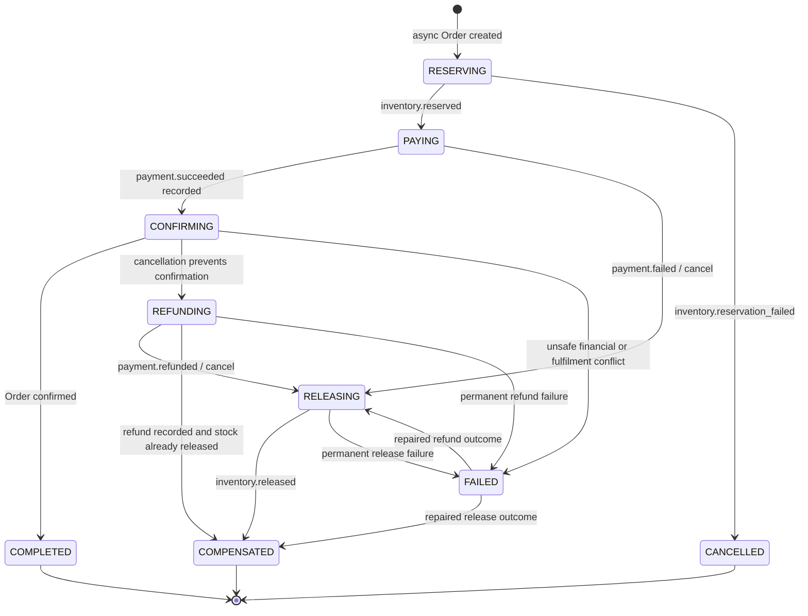

# Phase 8: durable checkout Saga

Order owns checkout policy and its durable `CheckoutSaga`. Inventory owns stock;
Payment owns financial effects. Coordinator reads and changes only Order's DB.
Default checkout remains synchronous. Async mode still requires
`EVENT_DRIVEN_CHECKOUT=true` on Order, Inventory and Payment.

Phase 7 receipts described deliveries, but could not explain an incomplete workflow.
Saga records active step, known reservation/release, payment identity/outcome and
failure metadata. One unique `orderId` ties its stable UUID to an Order. Async
creation commits Order, Saga and stored root event together. No generic framework,
new dependency, distributed transaction or Transactional Outbox is introduced.

## Separate guarantees

| Layer | Responsibility |
| --- | --- |
| Integration event | Validated V1 envelope and service-owned fact; correlation/cause chain |
| Consumer receipt | Deduplicate identical event ID/content; cache exact outgoing event for republication; reject changed content |
| Business idempotency | Inventory's conditional mutations and deterministic operation IDs; Payment's create/settle/refund keys and provider receipts |
| Saga | Persist workflow decisions and required/completed compensation across distinct messages |
| Domain lifecycle | Reject illegal Order/Payment transitions regardless of delivery/Saga status |

Saga cannot replace any other layer. Different event IDs do not authorize a second
charge or stock mutation. An identical receipt replay may republish its old output
after Saga advances; downstream receipts, operation keys and state guards make
that replay safe. No exactly-once transport claim is made.

## State machine and policy

| Input / condition | Persisted progress | Output / action |
| --- | --- | --- |
| Async Order creation | RESERVING | Stored `order.created`; Inventory reserves |
| Valid reservation | PAYING, reservation known | `checkout.payment_requested` |
| Reservation failure before any successful reservation | CANCELLED, inventory failure reason | Guarded Order cancellation, `order.cancelled`; no Payment request |
| Payment succeeds | CONFIRMING, payment ID/outcome and pending event fingerprint | Guarded Order confirmation; COMPLETED and `order.confirmed` |
| Payment declines | RELEASING, FAILED payment outcome | Guarded cancellation, `order.cancelled` |
| Order already cancelled or cancellation pending when cash succeeds | REFUNDING, SUCCEEDED payment outcome | `checkout.refund_requested` |
| Refund succeeds | REFUNDED outcome; RELEASING if held stock, otherwise COMPENSATED | Guarded cancellation and `order.cancelled` if needed |
| Release succeeds | Release flag; COMPENSATED only if refund not outstanding | No next output |
| Transient compensation failure after retry exhaustion | Current compensation state, retryable diagnosis | Original source goes to DLQ; repair/replay same event |
| Permanent compensation failure | FAILED, failed step and nonretryable diagnosis | Source goes to DLQ; no false compensation completion |

`COMPLETED`, `CANCELLED` (reservation failure) and `COMPENSATED` are finished states.
`FAILED` requires attention, not successful completion; repaired facts may resume
its failed compensation step. Active states remain unfinished after bounded retries.
Release arriving before refund sets release progress but cannot finish compensation.

Confirmation policy distinguishes three cases:

1. Transient SQL/infrastructure failure: payment acknowledgement is staged in a
   separate committed Order transaction before confirmation. CONFIRMING retains
   SUCCEEDED cash and the pending event fingerprint. Retry confirmation, never
   automatically refund for an unavailable DB. Same event ID with altered content
   remains rejected even before its final consumer receipt exists.
2. Valid cancellation prevents confirmation: refund existing Payment through its
   existing lifecycle/provider abstraction, then cancel/release. Stock and cash
   completion remain separate flags/outcomes.
3. Conflicting amount, pending fulfilment command, or consumed stock on a pending
   Order: retain SUCCEEDED cash and payment identity in FAILED/CONFIRMATION with
   `PAYMENT_DATA_CONFLICT` or `ORDER_COMMAND_CONFLICT`; no automatic destructive
   release/refund. Operator reconciliation required. Already confirmed/fulfilled
   Orders are never refunded solely because confirmation replay arrives late.

## Routing and service boundaries

Forward path:
`order.created` -> `inventory.reserved` -> Order coordinator ->
`checkout.payment_requested` -> `payment.succeeded` -> `order.confirmed`.

Decline path:
`payment.failed` -> `order.cancelled` -> `inventory.released` -> COMPENSATED.

Paid cancellation path:
`payment.succeeded` -> `checkout.refund_requested` -> `payment.refunded` ->
`order.cancelled` -> `inventory.released` -> COMPENSATED.

Four additive V1 contracts: Order-produced `checkout.payment_requested` and
`checkout.refund_requested`; Payment-produced `payment.refund_failed`;
Inventory-produced `inventory.release_failed`. Existing `payment.refunded` is reused.
Failure facts contain workflow IDs, fixed diagnostic code and retryable flag, not
provider secrets. Shared registry validates every input/output.

Existing queue names remain. Payment's queue now binds coordinator requests;
topology declaration removes its old direct `inventory.reserved` binding. Queued
Phase 7 reservation messages reaching Payment are forwarded unchanged to Order,
which decides whether payment is still appropriate. No Notification or Shipping
business consumer migration is included.

## Ordering, concurrency and recovery

Pure `classifySagaEvent` distinguishes transition/replay/stale/conflict. Duplicate
reservation cannot emit a second payment request. Reservation failure after known
reservation and payment failure after success conflict. Paid outcome after decline
conflicts; paid outcome after completed refund is stale. Paid outcome after cancelled
reservation failure conflicts because payment was never authorized. Identity,
correlation, amount and exact item quantities are validated for mutations.

Order's existing row is locked with `SELECT ... FOR UPDATE` before reading/changing
Saga and Order. Separate consumer connections therefore serialize on the same
workflow. Common Order conditional lifecycle persistence remains authoritative.
No process-local mutex, Saga version column or new advisory lock is needed. Existing
Phase 7 incoming-receipt and Inventory advisory locks remain unchanged.

| Interruption | Resume |
| --- | --- |
| Reservation commits before publication | Replay `order.created`; Inventory receipt returns same reserved outcome; coordinator requests Payment once |
| Payment commits before incoming receipt | Replay request; existing Payment/provider operation keys retain one effect |
| Cash acknowledged before Order confirmation | Replay paid event; CONFIRMING retries guarded confirmation |
| Cancellation commits before release | Replay source; cached cancellation republishes; deterministic release key converges |
| Refund commits before receipt/Saga update | Replay refund request; existing refund lifecycle returns persisted result without another financial effect |
| Release commits before coordinator progress | Replay cancellation/release fact; one stock release, then finish Saga |

Consumer processing uses existing three attempts (100ms/200ms backoff). Permanent
validation/domain errors skip retry. Compensation failure hook emits a confirmed
diagnostic fact before original handler fails; original source still NACKs without
requeue into service DLQ. Failed work never receives a successful receipt. Repair
underlying issue, inspect Saga, then replay original validated envelope with same
event ID/content. There is no automatic DLQ drain, polling resume API or endless
requeue loop. Nonretryable FAILED needs operator reconciliation before replay.

## Migration, rollout and observation

Additive `20261012010000_checkout_saga` creates table, enum, unique Order FK,
state/update-time index and payment-outcome constraint. Existing async Orders with
stored root events are backfilled: advanced Orders become COMPLETED; pending or
cancelled legacy workflows become FAILED/LEGACY_PROGRESS_REPLAY_REQUIRED because
Phase 7 lacks enough ledger data to infer compensation completion. Validated old
event replay can initialize conservative progress from its fact, including cached
receipt replay. Synchronous Orders receive no Saga. Legacy completed rows may lack
payment ID; migration does not read Payment's database to fabricate it.

Coordinated rollout: stop all three Phase 7 consumers, apply migrations/regenerate
clients, deploy all three Phase 8 services, then enable consumers together. Inspect
legacy attention rows and replay retained source events as needed. Do not run mixed
Phase 7/8 active workers; old Payment workers can bypass coordinator policy.

`GET /internal/orders/:id/checkout-saga` returns durable fields plus `terminal` and
`requiresAttention`. Existing gateway-secret protection applies; gateway blocks
internal routes. State/update-time index supports identifying stuck workflows.
Structured logs expose Saga/Order IDs, source event/correlation/causation,
classification, previous/next state and compensation diagnosis. Service readiness
continues to describe infrastructure/consumer health, never whether all Sagas finish.

## Remaining Phase 9 gap

DB commit and broker publication remain non-atomic, including root events,
coordinator outputs and failure diagnostics. Receipts cache outputs but are not an
Outbox or publication scheduler. Crash before publishing, exhausted confirms,
purged/lost messages or diagnostic publication failure require retained source
replay/operator repair. Publisher confirms alone cannot recover absent messages.
Cross-database cancellation/provider races still rely on persisted local guards,
compensation and replay; there is no global transaction or automatic reconciliation.
Transactional Outbox belongs to Phase 9. See [TESTING.md](../TESTING.md) for exact
verification counts and fault/race coverage.
