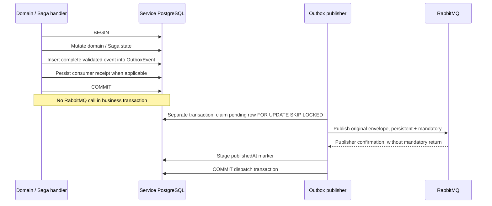

# Phase 9: transactional Outbox

Historical Phase 9 boundaries below are superseded for consumer processing by
[Phase 10 Inbox](phase10-idempotency.md): Payment's final financial transition,
Outbox and consumer receipt now share one transaction. Provider preparation and
acknowledgements remain separate as documented there.

Phase 8 Saga persists workflow policy; it cannot make PostgreSQL commit and RabbitMQ
publication atomic. A crash after a committed reservation, financial result or Saga
transition could lose its next event. Each producer now persists publication intent
in its own database transaction. Async checkout remains opt-in; synchronous HTTP
checkout, notifications and shipping remain unchanged.

## Actual transaction and dispatch boundary

Shared `processCheckoutEvent` inserts outputs into Outbox when the service's
transaction exposes its Outbox delegate. Saga/Inventory state, receipt and event
intent commit together. Receipt replay retains exact output; it does not rerun
business mutations. Consumer ACK now waits for durable publication intent rather
than immediate RabbitMQ publication. No consumer receipt or lifecycle guard is
removed and no new Inbox pattern is introduced.

Payment requires an additional boundary: its provider-backed financial transaction
was already independent of the surrounding consumer receipt transaction. Async
settlement/refund now commits Payment outcome and Outbox together in that financial
transaction. If the later receipt fails, intent still exists. Existing provider
operation keys recover acknowledgement-before-DB-commit failures. Synchronous
Payment commands keep their existing HTTP synchronization behavior and emit no new
integration events.

Order creates its root event, Saga and Outbox intent in the Order transaction.
Creation no longer contacts RabbitMQ or rejects an otherwise accepted checkout
because publishing is temporarily unavailable. HTTP same-key replay returns the
existing accepted response. Legacy stored-root replay ensures an Outbox row exists;
new roots never depend on that repair path for atomicity.

## Model and identities

Identical additive Prisma models/migrations live in Order, Inventory and Payment,
each using its own database. No central Outbox database or new microservice.

| Field | Meaning |
| --- | --- |
| `id` | UUID of producer persistence row; not integration event identity |
| `eventId` | Unique original logical integration-event UUID |
| `deduplicationKey` | Producer insertion key; eventId normally, `checkout:<source-eventId>` for financial outcome before receipt |
| `payload` | Full validated serialized envelope, including type/version, producer, data, occurredAt, correlation and cause |
| `createdAt` | Intent persistence timestamp |
| `publishedAt` | Null until confirmed publication and dispatch commit |
| `attempts` | Committed dispatch attempts |
| `lastError` | Safe diagnosis referring to correlated structured error log |
| `nextAttemptAt` | Earliest scheduled publication retry |

Composite `(publishedAt, nextAttemptAt, createdAt)` index supports pending polling.
Unique event ID and producer insertion key prevent duplicate intent rows. Application
replay of a financial operation returns its first envelope rather than replacing
eventId/occurredAt. Changed event ID content or changed keyed logical content conflicts.
Retries publish the stored envelope unchanged.

`correlationId` connects checkout across services. `causationId` names the triggering
event. Neither is the Outbox row ID or business-operation key. Consumer receipt
deduplicates delivery; Inventory operation IDs and Payment/provider idempotency keys
protect effects; Saga records workflow progress; domain guards protect legality.
All layers remain independently necessary.

## Producers inspected and migrated

| Producer | Outbox outputs / boundary |
| --- | --- |
| Order creation | `order.created`, atomic with Order/Saga/root snapshot |
| Order Saga | `checkout.payment_requested`, `checkout.refund_requested`, `order.confirmed`, `order.cancelled`, atomic with guarded Saga/Order decision and receipt |
| Inventory consumer | `inventory.reserved`, `inventory.reservation_failed`, `inventory.released`, atomic with conditional batch mutations/rollback and receipt |
| Payment async command | `payment.succeeded`, `payment.failed`, `payment.refunded`, atomic with financial result; later incoming receipt may fail independently |
| Compensation diagnostics | `inventory.release_failed`, `payment.refund_failed`, durably enqueued before original failed message NACK/DLQ |
| Legacy queued reservation forwarding in Payment | Same `inventory.reserved` envelope, durably enqueued; informational forwarding, no new stock/financial effect |

Failure diagnostics describe failed work, not a successful domain mutation; their
separate persistence does not mark failed work complete. Order's failure hook updates
local Saga diagnosis and emits no additional fact. Direct business publication is
removed from Order's old publisher module. Actual broker calls now belong to shared
dispatch. `inventory.consumed` and `order.processing_started` have contracts but no
existing async production publish site to convert; Phase 9 does not invent them or
change post-checkout synchronous lifecycle behavior.

## Polling, confirms, concurrency and lifecycle

One publisher loop per enabled service shares existing broker primitives with its
checkout consumer session. It starts after connection/topology/subscription setup.
Polling uses a single-row `SELECT ... FOR UPDATE SKIP LOCKED`, ordered by creation
time and row ID. Raw SQL is confined to this lock query because Prisma has no
equivalent lock API. Multiple processes skip rows already owned by another dispatch
transaction and can publish different rows concurrently.

Only the separate dispatch transaction remains open across confirm, holding an
Outbox row lock; original business/Saga transaction is already committed. No leases,
process-local correctness mutex or new advisory lock. Crash rolls back dispatch and
releases ownership. Dispatch has 1s max acquisition wait and 5s transaction timeout;
existing broker confirmation timeout is 3s.

Existing publisher sends persistent, mandatory messages, rejects unroutable returns
and negative/missing confirms, and waits for backpressure drain. `publishedAt` is
written only after that promise succeeds. Publication failures leave the row pending
and commit attempt/error/backoff: 500ms doubling up to 30s. Other due rows can advance.
Idle polling is 500ms; successful claims immediately schedule another poll. Dispatch
transaction failures are logged and retried; rolled-back attempts/markers cannot
be counted as committed attempts. Outbox retry has no destructive expiry or DLQ.

Session health is monitored every second. Lost/unhealthy broker session is drained
and recreated using existing connection/channel/topology primitives. Failed
reconnection retries later; pending intent remains in PostgreSQL. Initial startup
still requires configured healthy infrastructure. Readiness reports session health,
not zero backlog or completed Sagas. Stopped polling is not ready.

Shutdown's existing stopWork hook clears polling/reconnect timers immediately.
Cleanup awaits in-flight dispatch, drains/closes messaging and only then closes DB.
Consumers completing during drain may leave durable pending rows for restart.
Existing 8s shutdown policy remains authoritative. Tests check timer disposal and
confirmation drain; no endless polling handle remains after close.

Pino logs distinguish intent staged/persisted, dispatch attempt, confirmation,
publication failure, transaction failure and reconnection recovery. Event/Outbox
IDs, type, correlation and attempt are available without logging full payloads.
Confirmation log marks staged publication; only successful dispatch commit makes
the marker durable.

## Failure windows and delivery guarantee

| Failure | Durable outcome / recovery |
| --- | --- |
| Domain/Saga transaction rolls back | Both mutation and intent roll back; incoming delivery remains retryable |
| DB commit succeeds, crash before publish | Pending row rediscovered by publisher after restart; no client/source replay required for publication |
| RabbitMQ unavailable or confirm fails | Domain remains committed; intent pending with retry diagnosis/backoff; reconnect resumes |
| Provider acknowledgement precedes Payment transaction failure | Existing provider key replays one effect; Payment result and intent commit together on retry |
| Financial transaction commits, consumer receipt fails | Payment and intent survive; same-source replay reuses original output identity |
| Broker confirms, marker update/commit fails or process crashes | Row may remain pending; same event can publish again |
| Duplicate publication/delivery | Existing event-ID receipts and operation/provider keys prevent repeated stock/financial effects |
| Permanent consumer/business conflict | Existing bounded consumer policy and DLQ apply; Outbox does not repair invalid business transitions |

**At-least-once publication, not exactly-once delivery.** PostgreSQL cannot atomically
commit RabbitMQ confirmation. Confirm-before-marker intentionally prefers duplicate
publication over lost intent. Event ID never changes during dispatch retry. An
unknown DB commit result may already have stored the marker; polling skips it if so.
Multiple publishers do not guarantee global/cross-service event ordering; Saga's
late/conflicting event policy remains necessary.

## Migration and rollout

`20261013010000_transactional_outbox` is additive in all three services. It creates
table, uniqueness constraints and polling index; generated clients follow existing
checked-in convention. Existing receipt outputs are backfilled as pending using
their original event IDs. Order also backfills stored async roots. This intentionally
republishes retained facts, relying on existing deduplication rather than inventing
previous broker delivery markers. Synchronous state is not changed.

Apply migrations/regenerate clients, stop old Phase 8 workers and deploy all three
Phase 9 services together before enabling async workers. Old binaries cannot persist
new intent, so do not claim reliability for mixed active versions. No reset/drop of
development databases or volumes is required. Phase 8's conservative legacy Saga
attention state/reconciliation policy still applies.

## Remaining limits

- No atomic external provider/DB transaction: existing provider idempotency remains
  required. No cross-service distributed transaction or exactly-once claim.
- Outbox closes future local-DB/publication gaps; it cannot reconstruct historical
  missing envelopes absent retained root/receipt data or restore purged broker data.
- Published rows remain for diagnosis. Retention/pruning policy, backlog metrics,
  alerts and operational reconciliation are future work; no automatic row deletion.
- Business retries/DLQ repair remain Phase 7/8 policy. Published does not mean every
  consumer completed successfully. Outbox does not replace Saga recovery.
- No global ordering, automatic broker data-loss recovery, CDC, Kafka, Inbox,
  separate dispatcher service, new Saga framework, Notification/Shipping migration
  or deployment infrastructure.

See [TESTING.md](../TESTING.md) for exact results. SQL-trigger tests prove Saga and
financial rollback, receipt failure recovery, confirm-before-marker duplication and
separate-connection locking. Docker E2E stops disposable RabbitMQ, accepts committed
pending checkout, restarts messaging and proves convergence without client replay
with one reservation and one provider settlement.
